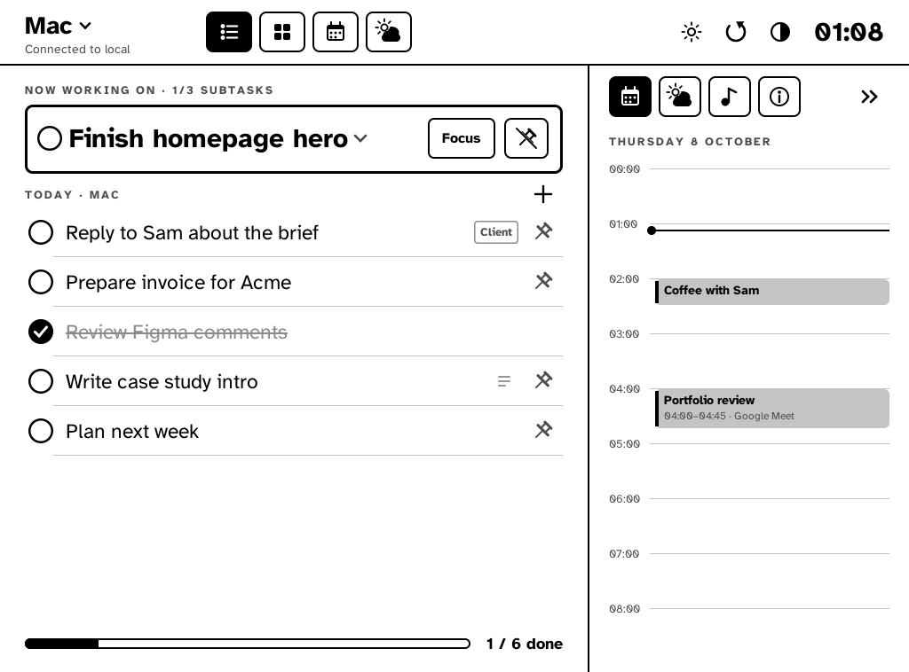
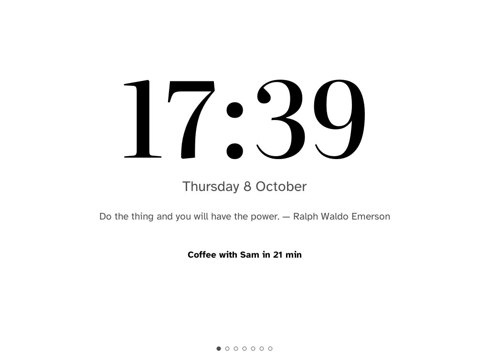
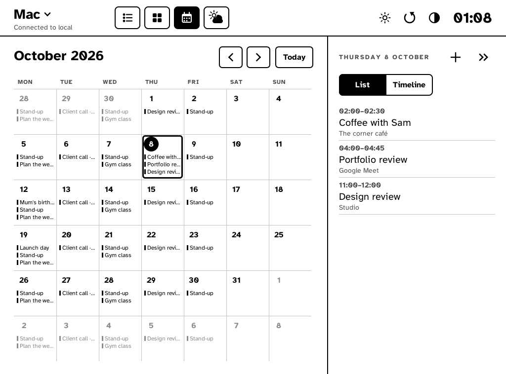
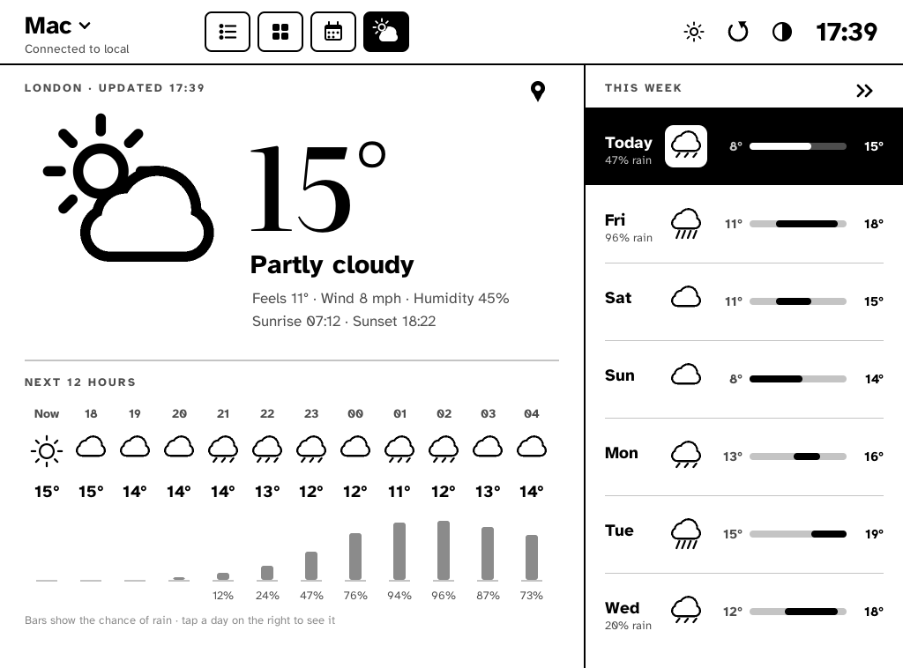
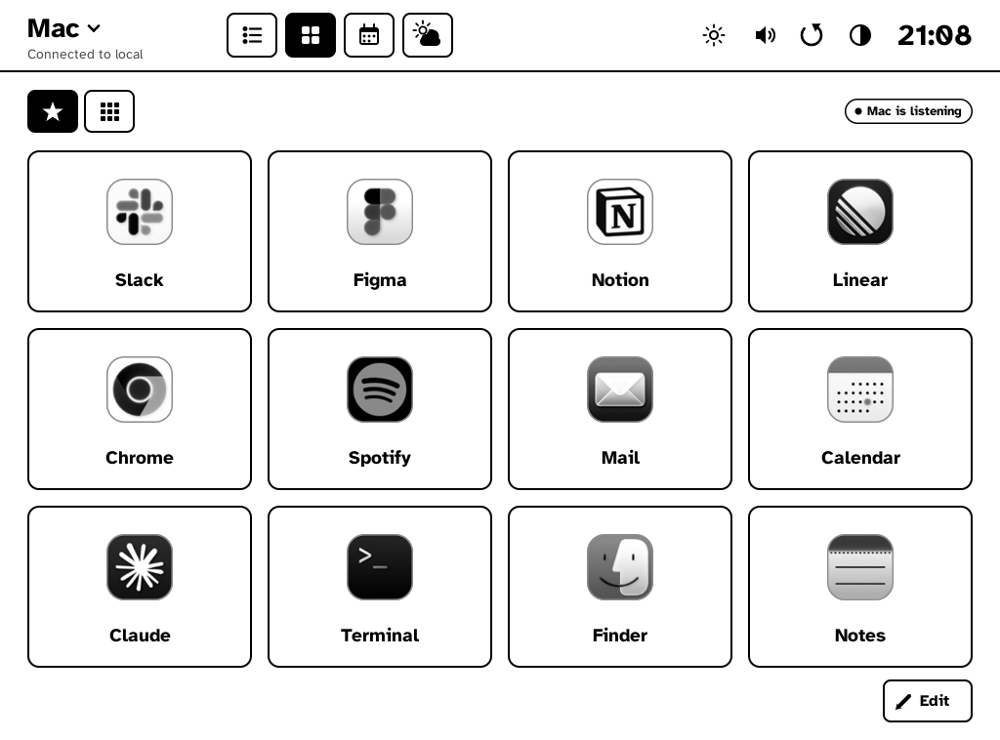
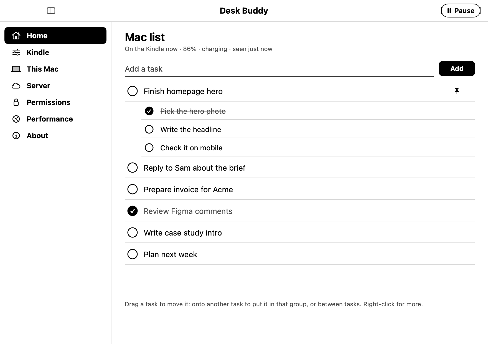
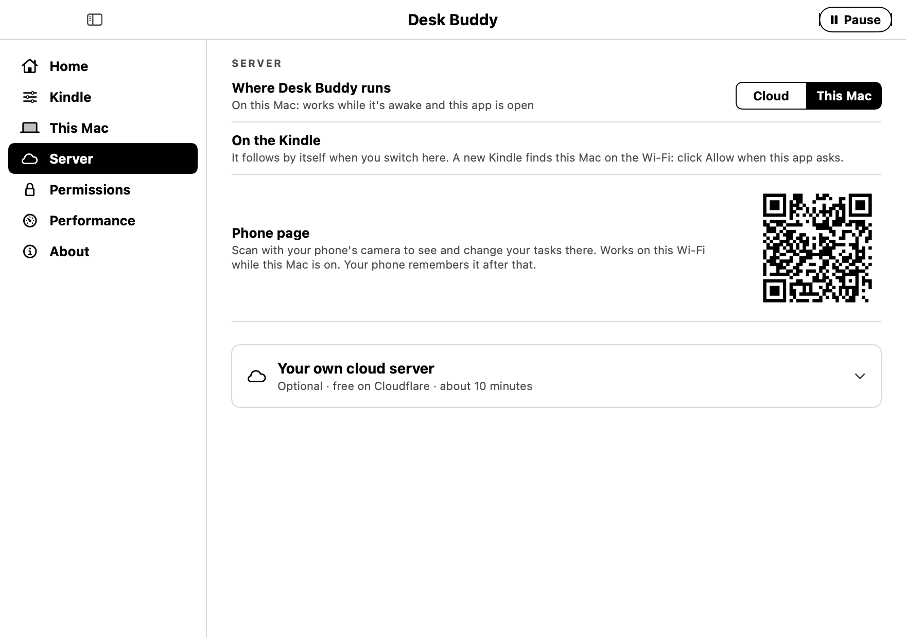
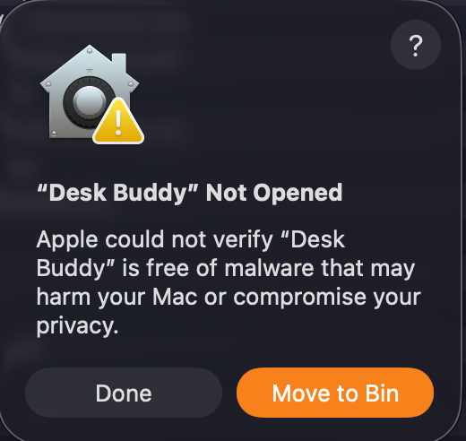

<p align="center">
  <picture>
    <source media="(prefers-color-scheme: dark)" srcset="docs/buddy-dark.png">
    
  </picture>
</p>

<h1 align="center">Desk Buddy</h1>

<p align="center"><b>Turn an old jailbroken Kindle into a calm desk companion.</b><br>Your tasks, calendar, weather, music and a clock, on e-ink, next to your computer.</p>

<p align="center">
  <a href="../../releases/latest/download/Desk-Buddy-for-Mac.zip"></a>
  &nbsp;
  <a href="../../releases/latest/download/Desk-Buddy-for-Windows.zip"></a>
</p>
<p align="center"><sub>The Kindle app comes with it: plug your jailbroken Kindle in and click once. <a href="#download">More download options</a></sub></p>

<p align="center">
 
</p>

<p align="center"><a href="#download">Download</a> · <a href="#what-you-need">What you need</a> · <a href="#set-up">Set up</a> · <a href="#compatibility">Compatibility</a> · <a href="#known-issues">Known issues</a> · <a href="docs/troubleshooting.md">Troubleshooting</a> · <a href="#privacy">Privacy</a></p>

---

## Download

*For the non-smelly nerds.* No code, no building, no terminal. Pick your device, download, open.

| | | |
|---|---|---|
| 💻 **Mac** | [**Download Desk Buddy for Mac**](../../releases/latest/download/Desk-Buddy-for-Mac.zip) | **Move it to Applications**, open it, and allow it once ([the steps](#set-up)). macOS 13 or newer. |
| 🪟 **Windows** | [**Download Desk Buddy for Windows**](../../releases/latest/download/Desk-Buddy-for-Windows.zip) | Early test version. Unzip and open *Desk Buddy.exe*. |
| 📖 **Kindle** | **Nothing to download:** Desk Buddy for Mac or Windows puts it on your Kindle | Plug your jailbroken Kindle in with USB and click **Put Desk Buddy on it**. After that it updates itself over Wi-Fi. |

Rather copy it yourself? [Download Desk Buddy for Kindle](../../releases/latest) and follow [the steps](docs/install-kindle.md), or click **Save the files instead…** in the app.

Smelly nerds: the code is all here, and [docs/building.md](docs/building.md) shows how to build it yourself. We love you too.

## What it does

- **Tasks** with subtasks, a pinned **Now working on** card and a **Pomodoro** focus timer. Ticking a task ticks its subtasks.
- **A list per computer** (Mac / Windows) that follows the one you're using, or one list for everything.
- **Calendar**: today beside your tasks, a month view, and a heads-up before meetings with a **Join** button (Zoom, Meet, Teams, Webex and more).
- **Weather** for your town (today and the week).
- **Standby clocks** and **8 themes**: Plain, Garden, Sketch, Classic, Retro, Notebook, Typewriter, Game Boy.
- **Deck**: tap a tile on the Kindle to open an app on your computer.
- **Music**: what's playing in Spotify or Apple Music, album covers, play / pause / skip, volume, and which speakers it plays on.
- **Phone page**: see and change your tasks from your phone. Scan a QR code once.
- **AI assistants**: let Claude Code or Codex add, tick and change your tasks when you ask ([how](docs/ai-tasks.md)).
- **Calm e-ink**: light and dark, four fonts, gentle screen refreshes (no needless flashing), a first-run tour.
- **Updates itself over Wi-Fi.** You tap Install; it never updates on its own.
- **Works offline**: the Kindle keeps showing your last screen, and changes you make wait until the server is back.

<p align="center"> </p>

<p align="center"> </p>

## Desk Buddy for Mac

A small app in your menu bar connects your Mac. It runs Desk Buddy's server (so there's nothing else to set up), tells the Kindle when you're at your Mac, sends your calendar and what's playing, and opens apps when you tap the Deck. Its window has your **task list** (drag to reorder, subtasks, pin), **all the Kindle's settings**, the **phone page QR code**, the **permissions** with what each one shares, and how little it uses.

<p align="center"> </p>

## What you need

- **A jailbroken touch Kindle.** Tested on the **Kindle Paperwhite 2** (see [Compatibility](#compatibility)). Jailbreak it with [kindlemodding.org](https://kindlemodding.org), including the hotfix.
- **A Mac** with macOS 13 Ventura or newer, **or a Windows 10 / 11 PC** (early test version).
- **A USB cable, once**: Desk Buddy for Mac or Windows puts Desk Buddy on the Kindle for you. After that it updates over Wi-Fi.
- **That's it.** No account, no subscription. Desk Buddy runs its own small server on your computer.

Optional: your own free **Cloudflare** server, so the Kindle and your phone keep working while your Mac sleeps or you're away. See [docs/cloud.md](docs/cloud.md).

## Set up

About 15 minutes, once.

1. **Mac** (about 70 MB, macOS 13 or newer):
   1. **Download** [Desk-Buddy-for-Mac.zip](../../releases/latest/download/Desk-Buddy-for-Mac.zip). Safari unzips it by itself; in other browsers, double-click the zip in Downloads.
   2. **Move it to Applications:** open Finder, and drag **Desk Buddy** from **Downloads** onto **Applications** in the sidebar.
   3. **Open Desk Buddy** from Applications. macOS shows this, because the app isn't signed by Apple (that needs a paid membership):

      

      Click **Done**. **Not** "Move to Bin".
   4. Open **System Settings › Privacy & Security**, scroll down to *"Desk Buddy" was blocked…* and click **Open Anyway** (it asks for your password).
   5. **Open Desk Buddy again** and click **Open**. That's the last time macOS asks.

   Desk Buddy then walks you through the rest. More detail (and macOS 13–14): [docs/install-mac.md](docs/install-mac.md).
2. **Kindle**: plug it into your Mac with USB. Desk Buddy says **Kindle found**: click **Put Desk Buddy on it**. It copies itself over, checks every file landed, and ejects the Kindle. Unplug it and open **Desk Buddy** from the Kindle's library.

   > **Didn't work?** (the app doesn't find the Kindle, or says files didn't stick) Copy it by hand instead: download **Desk-Buddy-for-Kindle.zip** from [Releases](../../releases) (or click **Save the files instead…** in the app), unzip it, copy the **`desk`** folder to the top of the Kindle drive and **`Desk Buddy.sh`** into its **`documents`** folder, then eject. Step by step, with USB tips: [docs/install-kindle.md](docs/install-kindle.md#if-that-doesnt-work-copy-it-by-hand).
3. **That's it**: it's already set up for your Mac, so it connects by itself. (Copied it by hand? On the Kindle tap **Find it**, pick your Mac, and click **Allow** on the Mac.)

From then on: everything happens on the Mac (Desk Buddy in the menu bar) or on the Kindle itself, and new versions arrive over Wi-Fi.

## Compatibility

| | |
|---|---|
| **Kindle Paperwhite 2** (6th gen, 2013), firmware 5.12.x | ✅ Tested, daily use |
| Other touch Kindles (Paperwhite 3 / 4 / 5, Oasis, Basic) | ❌ Not yet. The layout is made for the PW2's screen (1024 × 758) and touch panel. Support for other screens is planned. |
| Kindles without a touchscreen | ❌ No |
| Jailbreak | The [kindlemodding.org](https://kindlemodding.org) jailbreak **with its hotfix** (it provides FBInk, the root helper and the script launcher Desk Buddy uses). KUAL isn't needed. |
| Kindle Wi-Fi | 2.4 GHz, WPA2 (the Paperwhite 2 can't join 5 GHz-only or WPA3-only networks) |
| **Mac** | macOS 13 Ventura or newer. Apple Silicon: tested. Intel: the download is built for it too, but nobody has tried it on an Intel Mac yet. |
| **Windows** | Windows 10 / 11 (64-bit). Early test version: tasks, the Kindle's settings, the Deck, music, volume, calendar links and putting Desk Buddy on a Kindle. |
| Phone page | Any modern phone browser (iPhone, Android) |
| Music | Spotify and Apple Music desktop apps on the Mac; on Windows anything that shows in Windows' media controls (Spotify, Apple Music, browsers…) |
| Calendar | Everything in the Mac's Calendar app (iCloud, Google, Exchange, … accounts added there), plus calendar links (.ics) added on the phone page |
| Own cloud server | Cloudflare's free plan (Workers + D1) |

## How it works

```
 Kindle (draws the screen)  ⇄  Desk Buddy server  ⇄  Desk Buddy for Mac (menu bar)
                                on your Mac, or in       tells it which computer you're on,
                                your own Cloudflare      sends your calendar and music,
                                account                  opens Deck apps
```

The server keeps everything (tasks, settings, calendar, weather). The Kindle asks it for one screen at a time and sends your taps back; the Mac app connects your computer. Switching between your Mac and the cloud happens in the Mac app, and the Kindle follows by itself.

## How it came about, and the hiccups

I found a 10+ year old Kindle Paperwhite lying around the house and wanted a calm, paper-like screen on my desk for my tasks, instead of another glowing window.

**A note on AI:** this was a side project, and I'd never programmed a Kindle before, so I built Desk Buddy with the help of AI. That's what made it possible to turn it into something other people can actually use. I designed it and tested it on my own Kindle and computers.

Desk Buddy grew from there, with a few bumps along the way:

- **The Kindle kept dropping its USB connection.** Copying anything big made it disconnect and reconnect, and on macOS 26 files sometimes looked copied but were gone after ejecting. So I stopped using USB for anything but the very first install: **Desk Buddy updates itself over Wi-Fi.**
- **That's really why the cloud option exists.** It's overkill for most people, but running the server on my own (free) Cloudflare account meant I could push new versions to the Kindle over the internet, any time, without plugging it in, and it keeps working while my Mac sleeps. For everyone else, the default runs on your own Mac and needs nothing.
- **The clock crashed once** because the Kindle is a 32-bit device and a timestamp overflowed. Fixed, and the Kindle now reports a screen that fails to draw instead of falling over.
- **Deck taps fired late:** tapping tiles I thought were placeholders queued them up and opened apps minutes later. Now a tap only counts for 30 seconds.
- **Too much e-ink flashing**, so there's a Screen refresh setting (Gentle / Normal / Clean) and it only redraws what changed.
- **Weak Wi-Fi at the desk** made the Kindle go offline more than once. A router restart fixed it every time (see [Troubleshooting](docs/troubleshooting.md)).

## Known issues

- **Only the Paperwhite 2** works for now (see [Compatibility](#compatibility)).
- **The first install needs USB.** On macOS 26, USB with Kindles can be flaky (the drive disconnects, or files you copied don't stick). Copy, eject properly, and check the files are there; tips in [docs/install-kindle.md](docs/install-kindle.md).
- **The Mac app isn't signed** by Apple yet (a paid developer membership): the first time, allow it once in System Settings › Privacy & Security › **Open Anyway** (macOS 15+) or with right-click › **Open** (macOS 13–14). macOS may also ask for its permissions again after each update.
- **The Mac download is about 70 MB**, because it carries Desk Buddy's server for both Apple Silicon and Intel Macs.
- **The downloads are brand new.** They're built and checked, but haven't been tried yet on a fresh Mac, an Intel Mac or someone else's PC. If something doesn't work, please [open an issue](../../issues).
- **On "This Mac"** (the default), the Kindle only updates while your Mac is awake, on the same Wi-Fi, with Desk Buddy open. It shows your last screen meanwhile and catches up when the Mac is back. Want it always on? Use your own [cloud server](docs/cloud.md).
- **After the Kindle restarts**, open Desk Buddy from the library again (it doesn't start by itself).
- **Weak Wi-Fi at the desk** makes the Kindle slow or offline. Restarting the router has fixed it more than once.
- **Spotify** sometimes reports nothing playing through its AppleScript; play / pause once and it catches up. Music playing on another device (Spotify Connect) doesn't show.
- **Apple Music covers** only show for songs that have artwork stored on your Mac.
- **Speaker switching** changes your Mac's sound output, not Spotify Connect devices.
- **Windows** is an early test version: calendars come from calendar links (Google, Outlook), as Windows' own calendar can't be read; and as it isn't signed (that costs money), Windows may warn the first time: **More info › Run anyway**.
- **Windows Defender flagged an early test version as `Trojan:Win32/Sabsik.TE.A!ml`.** The `!ml` means it was a machine-learning guess, not a known virus: it's a common false alarm for small unsigned programs. What set it off in version 0.6 was the app running a hidden PowerShell command to eject the Kindle after copying Desk Buddy onto it. Since 0.6.2 it ejects the Kindle through Windows' own drive commands and runs no PowerShell or scripts at all. If Defender still complains, you can [report it to Microsoft as a false positive](https://www.microsoft.com/en-us/wdsi/filesubmission), and all the code is here to check.

Something else? [Open an issue](../../issues).

## Privacy

**In short:** your tasks, calendar and everything else stay on your own computer (or your own cloud server, if you set one up). There's no Desk Buddy server, no account and no tracking.

Your data only goes to **your own** Desk Buddy server: on your Mac (the default), or in your own Cloudflare account if you set one up. There's no Desk Buddy company server, no ads, no tracking, no analytics, and nothing is sold or shared.

Two things leave your network on purpose: the weather asks [Open-Meteo](https://open-meteo.com) for your town's forecast, and album covers come from Spotify.

**Every permission explained** (calendar, music, Bluetooth), what it reads, why, and where it goes: [docs/privacy.md](docs/privacy.md).

### A word of caution

Even if I'm arguing against myself here: it's good practice not to download random apps from the internet and install them, and I completely agree with that. I've made sure Desk Buddy is safe, and all of its code is here for anyone to read. But if you're not sure what you're doing, maybe wait until someone more knowledgeable has had a look at it. Please be careful in general.

## More

- [docs/install-mac.md](docs/install-mac.md): installing and using the Mac app
- [docs/install-kindle.md](docs/install-kindle.md): putting Desk Buddy on the Kindle, using it, updating, removing it
- [docs/cloud.md](docs/cloud.md): your own free cloud server (optional)
- [docs/privacy.md](docs/privacy.md): what Desk Buddy sees, why, and where it goes
- [docs/ai-tasks.md](docs/ai-tasks.md): let an AI assistant manage your tasks
- [docs/troubleshooting.md](docs/troubleshooting.md): when something doesn't work
- [docs/building.md](docs/building.md): building it yourself, and how the code is laid out
- [CONTRIBUTING.md](CONTRIBUTING.md): ideas, bugs and pull requests

## Credits

[FBInk](https://github.com/NiLuJe/FBInk) by NiLuJe, [KindleModding](https://kindlemodding.org) (jailbreak and the script launcher), [Open-Meteo](https://open-meteo.com), [ical.js](https://github.com/kewisch/ical.js), [go-qrcode](https://github.com/skip2/go-qrcode). Fonts, all under the SIL Open Font License (texts in `kindle/desk/fonts/`): Atkinson Hyperlegible, Literata, Inter, Bitter, Courier Prime, Press Start 2P.

"Kindle" is a trademark of Amazon; Spotify and Apple Music belong to their owners. Desk Buddy isn't affiliated with or endorsed by any of them.

## License

[MIT](LICENSE)
